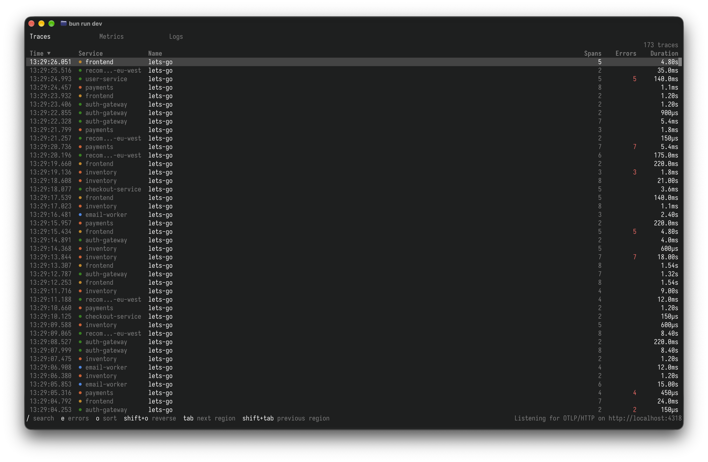

# otel-tui

A terminal app for viewing OpenTelemetry traces, metrics, and logs.

Send it data over OTLP/HTTP and browse it in your terminal. Picking a service
or time range in one view filters the others.



## Views

- Traces: trace list works today. Span table, waterfall, and duration
  histogram are planned.
- Metrics: planned (line chart with a time brush).
- Logs: planned (table, severity histogram, text search).

## Usage

Requires [Bun](https://bun.sh).

```shell
bun install
bun run start
```

Point your OTLP/HTTP exporter at `http://localhost:4318`. Data lives in memory
and auth is off, so it only suits local use.

| Variable                     | Default | Meaning                      |
| ---------------------------- | ------- | ---------------------------- |
| `OTEL_TUI_PORT`              | `4318`  | Port the receiver listens on |
| `OTEL_TUI_RETENTION_MINUTES` | `60`    | How long telemetry is kept   |

## Development

Sample data comes from OpenTelemetry's
[`telemetrygen`](https://github.com/open-telemetry/opentelemetry-collector-contrib/tree/main/cmd/telemetrygen)
(`go install github.com/open-telemetry/opentelemetry-collector-contrib/cmd/telemetrygen@latest`):

```shell
bun run start        # in one terminal
bun run gen:traces   # in another (also gen:logs, gen:metrics)
```

```shell
bun run check
bun run test
```

## How it works

An in-memory DuckDB runs the receiver from its
[`otlp` community extension](https://duckdb.org/community_extensions/extensions/otlp).
Each view queries DuckDB with SQL built from the shared filters, and
[OpenTUI](https://opentui.com/) draws the results.

- `src/db/`: DuckDB instance and OTLP receiver.
- `src/tui/`: views and charts.
