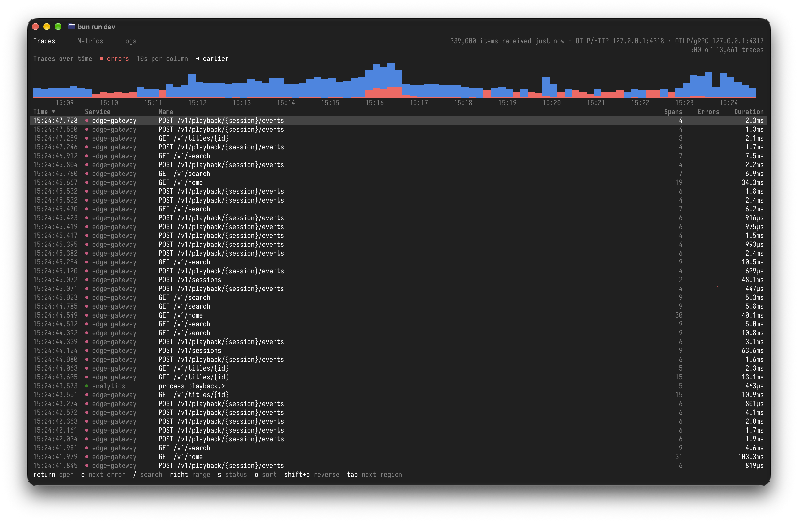
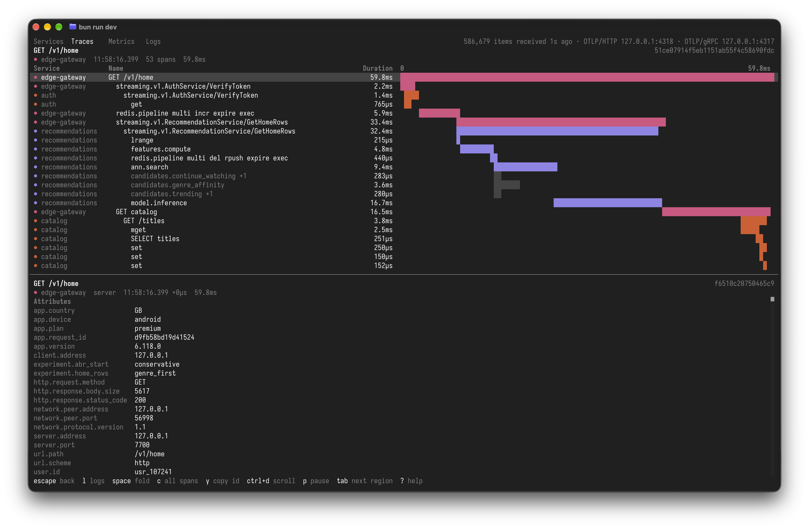
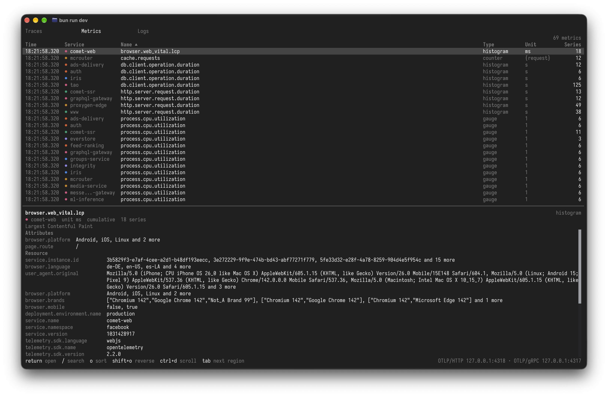
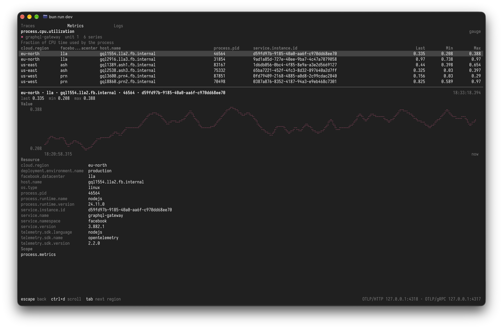
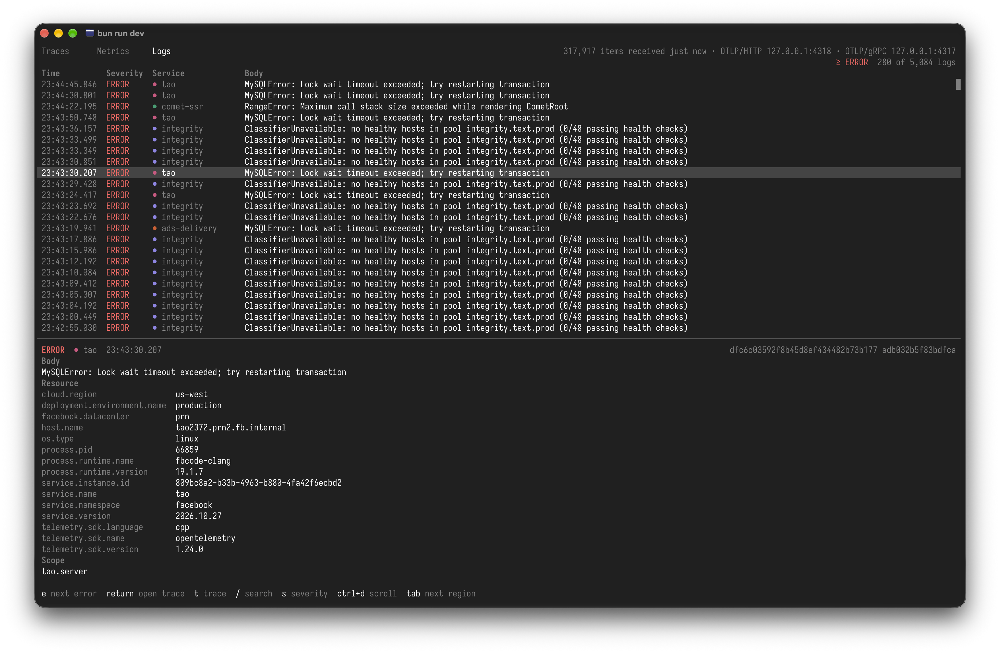

# otel-tui

A terminal app for viewing OpenTelemetry traces, metrics, and logs.

Send it data over OTLP/HTTP or OTLP/gRPC and browse it in your terminal.











## Views

- Traces: the trace list works today, and `return` opens a trace as a span
  waterfall with each span's events, attributes, links, and resource, and
  `l` there opens the trace's logs (`shift+l` only the selected span's). `e` jumps to the next trace or span
  with errors, and `s` shows only traces with errors. `o` sorts by start
  time, span count, error count, or duration, `shift+o` reverses the order,
  `ctrl+d` and `ctrl+u` move half a page, and `/` searches trace IDs, span
  names, and services. A histogram above the
  list charts the traces over time in 10-second columns, with the errors in
  red, so a spike or a gap stands out.
  `←` or `→` marks the latest column with traces and narrows the list to it;
  they then move the mark to the previous or next column with traces,
  scrolling the chart along, and `escape` clears it.
- Metrics: the metric list shows each metric's type, unit, and series count,
  with a panel listing the values each attribute takes, so an attribute that
  blows up cardinality stands out. `return` opens a metric's series with
  their rates, last values, or percentiles, plus the selected series' chart,
  histogram buckets, and exemplars. `tab` moves into the exemplars, where
  `return` opens an exemplar's trace at its span; exemplars whose trace
  otel-tui never received are marked "not stored". `o` sorts by name, series count, or last
  update, `shift+o` reverses the order, and `/` searches names, descriptions,
  services, and attributes. A time brush is planned.
- Logs: the log table works today, with a panel for the selected log's body,
  attributes, resource, and trace ID. `e` jumps to the next error, `return`
  opens the selected log's trace (`escape` there comes back to the log), `t`
  shows only the logs in that trace, `s` raises the minimum severity, and `/`
  searches bodies, attributes, services, and trace IDs. A severity histogram
  is planned.

In every view, `?` lists every key the focused page takes, including the
ones the footer leaves out. `p` pauses live updates so rows stop moving while you read
them, and `y` copies the selected trace ID, span ID (`shift+y` the trace
ID), log body, or metric name. Searches also take `key=value` terms that
match a span, log, or metric attribute or a resource attribute exactly, as in
`http.route=/api/cart service.name=cart`.

## Usage

Requires [Bun](https://bun.sh).

```shell
bun install
bun run start
```

Point your OTLP exporter at `http://localhost:4318` for OTLP/HTTP or
`http://localhost:4317` for OTLP/gRPC. Auth is off, so it only suits local use.

Telemetry is kept in memory for the retention period. When it nears the memory
limit, the oldest telemetry is dropped first. A burst that outpaces this spills
to a temporary directory for a few seconds, which is removed on exit.

| Variable                     | Default | Meaning                      |
| ---------------------------- | ------- | ---------------------------- |
| `OTEL_TUI_HTTP_PORT`         | `4318`  | Port for OTLP/HTTP           |
| `OTEL_TUI_GRPC_PORT`         | `4317`  | Port for OTLP/gRPC           |
| `OTEL_TUI_RETENTION_MINUTES` | `60`    | How long telemetry is kept   |
| `OTEL_TUI_MEMORY_LIMIT_MB`   | `1024`  | Memory for telemetry, in MiB |

## Development

Sample data comes from OpenTelemetry's
[`telemetrygen`](https://github.com/open-telemetry/opentelemetry-collector-contrib/tree/main/cmd/telemetrygen)
(`go install github.com/open-telemetry/opentelemetry-collector-contrib/cmd/telemetrygen@latest`):

```shell
bun run start        # in one terminal
bun run gen:traces   # in another (also gen:logs, gen:metrics)
```

For realistic data, `bun run demo:up` runs the
[OpenTelemetry Demo](https://opentelemetry.io/docs/demo/) in Docker: an online
shop of about 20 services in different languages, with a load generator and
feature flags that inject failures. Its collector exports everything to
otel-tui on `OTEL_TUI_HTTP_PORT`. It needs about 6 GB of memory for Docker; stop
it with `bun run demo:down`.

```shell
bun run check
bun run test
```

### Debugging

Press <kbd>`</kbd> to toggle the console. It shows `console.*`output, failed
queries with their query key, and keymap warnings. The app runs in`StrictMode`.

```shell
npx react-devtools@7     # in one terminal
bun run dev:devtools     # in another: inspect the React tree and state
bun run dev:stats        # render statistics overlay
OTUI_DUMP_CAPTURES=true bun run start  # print captured output on exit
```

## How it works

An in-memory DuckDB runs the receiver from its
[`otlp` community extension](https://duckdb.org/community_extensions/extensions/otlp).
Each view queries DuckDB with SQL built from its own search and filters, and
[OpenTUI](https://opentui.com/) draws the results.

- `src/receiver/`: DuckDB instance and OTLP receiver.
- `src/tui/`: views and charts.
