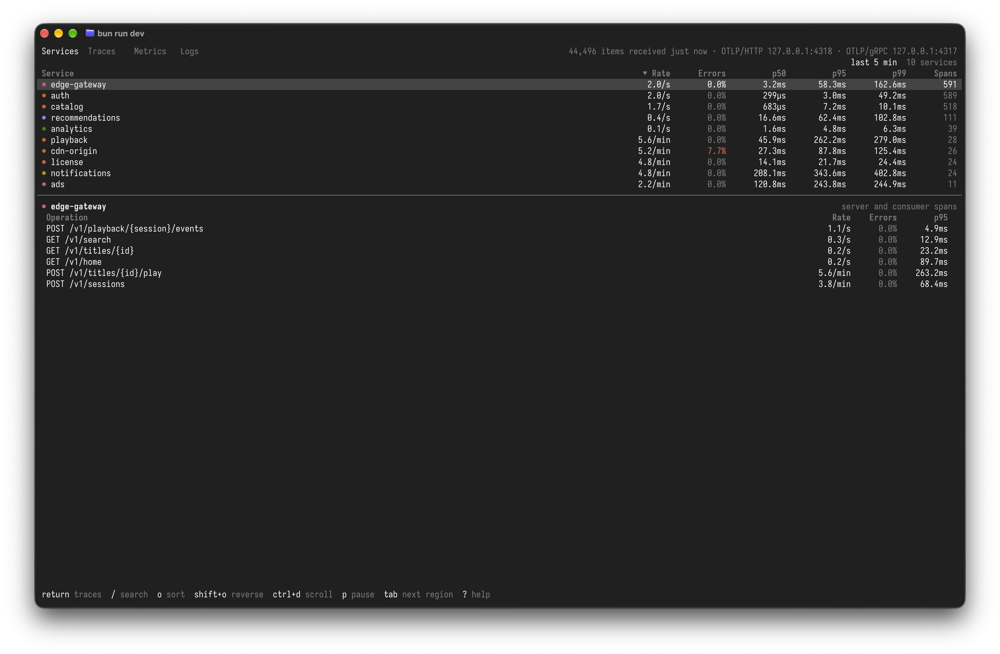

# otel-tui

A terminal app for viewing OpenTelemetry traces, metrics, and logs.

Send it data over OTLP/HTTP or OTLP/gRPC and browse it in your terminal.



## Views

### Services

The app opens here. Each service's rate, error rate, and p50, p95, and p99
latency over the last 5 minutes come from its server and consumer spans, with
the selected service's operations below. `return` opens the service's traces,
`o` sorts by rate, errors, or p95, and `/` searches service names. `tab` moves
into the operations, where `return` opens the traces with that operation,
slowest first. A trace opened from there starts at the operation's span.

### Traces

<p>
  
  
</p>

A histogram above the list charts the traces over time in 10-second columns,
with the errors in red, so a spike or a gap stands out. `←` or `→` marks the
latest column with traces and narrows the list to it, then moves the mark to
the previous or next column, and `escape` clears it. `e` jumps to the next
trace with errors, `s` shows only traces with errors, `o` sorts by start time,
span count, error count, or duration, `shift+o` reverses the order, `ctrl+d`
and `ctrl+u` move half a page, and `/` searches trace IDs, span names, and
services.

`return` opens a trace as a span waterfall with each span's events,
attributes, links, and resource. `space` folds or unfolds the selected span's
children, and `c` dims every span off the critical path, the chain of spans
that sets how long the trace takes. `e` there jumps to the next span with errors,
`l` opens the trace's logs, and `shift+l` only the selected span's. `tab`
moves into the span's links, where `return` opens the linked trace, or selects
the linked span when it is in the same trace.

### Metrics

<p>
  
  
</p>

The metric list shows each metric's type, unit, and series count, with a
panel listing the values each attribute takes, so an attribute that blows up
cardinality stands out. `o` sorts by name, series count, or last update,
`shift+o` reverses the order, and `/` searches names, descriptions, services,
and attributes.

`return` opens a metric's series with their rates, last values, or
percentiles, plus the selected series' chart, histogram buckets, and
exemplars. `tab` moves into the exemplars, where `return` opens an exemplar's
trace at its span; exemplars whose trace otel-tui never received are marked
"not stored". `w` narrows the chart to the last 15, 5, or 1 minute, and
`shift+w` widens it again.

### Logs


The log table comes with a panel for the selected log's body, attributes,
resource, and trace ID. `e` jumps to the next error, `return` opens the
selected log's trace (`escape` there comes back to the log), `t` shows only
the logs in that trace, `s` raises the minimum severity, and `/` searches
bodies, attributes, services, and trace IDs. A histogram above the table
charts the logs over time with the errors in red, and `←` or `→` narrows the
table to a column, as on Traces.

### Everywhere

Click a tab to switch to it, or a row to select it and move the focus
there; the wheel scrolls lists. `?` lists every key the focused page takes, including the ones the footer
leaves out. `p` pauses live updates so rows stop moving while you read them,
`ctrl+l` deletes all telemetry and starts the current tab over,
and `y` copies the selected trace ID, span ID (`shift+y` the trace ID), log
body, or metric name. Searches also take `key=value` terms that match a span,
log, or metric attribute or a resource attribute exactly, as in
`http.route=/api/cart service.name=cart`. `key!=value` matches a different
value. Like every term, it matches single spans, so `service.name!=cart` still
lists the traces that pass through cart. `>`, `>=`, `<`, and `<=` compare
numbers, as in `http.response.status_code>=500`. On Traces, `duration` compares
each span's duration, in `ns`, `us`, `ms`, `s`, `m`, or `h` (`ms` when you
leave the unit out), as in `duration>500ms http.route=/api/cart`.

## Usage

Install with [Homebrew](https://brew.sh) on macOS or Linux:

```shell
brew install michaltarasiuk/tap/otel-tui
```

Or download the archive for your system from the
[latest release](https://github.com/michaltarasiuk/otel-tui/releases/latest)
(macOS and Linux, arm64 and x64), unpack it, and run `otel-tui`:

```shell
tar -xzf otel-tui-darwin-arm64.tar.gz
./otel-tui-darwin-arm64/otel-tui
```

The first run unpacks DuckDB into `~/.cache/otel-tui` and downloads its OTLP
extension, so it needs network access once.

To run from source instead, install [Bun](https://bun.sh):

```shell
bun install
bun run start
```

Point your OTLP exporter at `http://localhost:4318` for OTLP/HTTP or
`http://localhost:4317` for OTLP/gRPC. Auth is off, so otel-tui listens only on
`127.0.0.1` unless you pass `--host`. To receive telemetry from containers, as
on Linux Docker, use `--host 0.0.0.0` and point the exporter at
`host.docker.internal` or the host's address, but only on a network you trust:
anyone who can reach the port can send data.

Telemetry is kept in memory for the retention period. When it nears the memory
limit, the oldest telemetry is dropped first. A burst that outpaces this spills
to a temporary directory for a few seconds, which is removed on exit.

| Flag             | Variable                     | Default     | Meaning                      |
| ---------------- | ---------------------------- | ----------- | ---------------------------- |
| `--host`         | `OTEL_TUI_HOST`              | `127.0.0.1` | Address to listen on         |
| `--http-port`    | `OTEL_TUI_HTTP_PORT`         | `4318`      | Port for OTLP/HTTP           |
| `--grpc-port`    | `OTEL_TUI_GRPC_PORT`         | `4317`      | Port for OTLP/gRPC           |
| `--retention`    | `OTEL_TUI_RETENTION_MINUTES` | `60`        | How long telemetry is kept   |
| `--memory-limit` | `OTEL_TUI_MEMORY_LIMIT_MB`   | `1024`      | Memory for telemetry, in MiB |

A flag wins over its variable. `otel-tui --help` lists them, and
`otel-tui --version` prints the version.

## Development

Sample data comes from OpenTelemetry's
[`telemetrygen`](https://github.com/open-telemetry/opentelemetry-collector-contrib/tree/main/cmd/telemetrygen)
(`go install github.com/open-telemetry/opentelemetry-collector-contrib/cmd/telemetrygen@latest`):

```shell
bun run start        # in one terminal
bun run gen:traces   # in another (also gen:logs, gen:metrics)
```

For realistic data, `bun run demo:up` runs the
[OpenTelemetry Demo](https://opentelemetry.io/docs/demo/) in Docker: an online
shop of about 20 services in different languages, with a load generator and
feature flags that inject failures. Its collector exports everything to
otel-tui on `OTEL_TUI_HTTP_PORT`. It needs about 6 GB of memory for Docker; stop
it with `bun run demo:down`.

```shell
bun run check
bun run test
```

`bun run build [platform] [arch]` compiles a standalone binary into `dist/`,
for the current system by default. Pushing a `v*` tag builds every platform
and publishes a GitHub release.

### Debugging

Press <kbd>`</kbd> to toggle the console. It shows `console.*`output, failed
queries with their query key, and keymap warnings. The app runs in`StrictMode`.

```shell
npx react-devtools@7     # in one terminal
bun run dev:devtools     # in another: inspect the React tree and state
bun run dev:stats        # render statistics overlay
OTUI_DUMP_CAPTURES=true bun run start  # print captured output on exit
```

## How it works

An in-memory DuckDB runs the receiver from its
[`otlp` community extension](https://duckdb.org/community_extensions/extensions/otlp).
Each view queries DuckDB with SQL built from its own search and filters, and
[OpenTUI](https://opentui.com/) draws the results.

- `src/receiver/`: DuckDB instance and OTLP receiver.
- `src/tui/`: views and charts.
