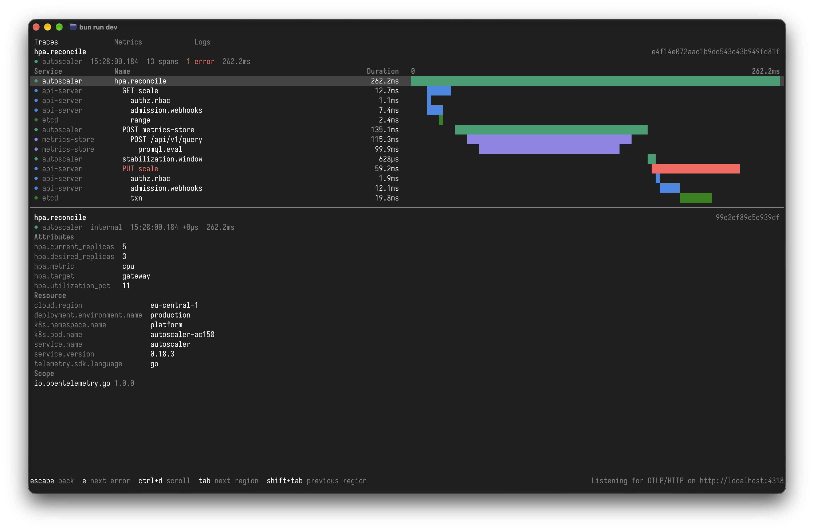
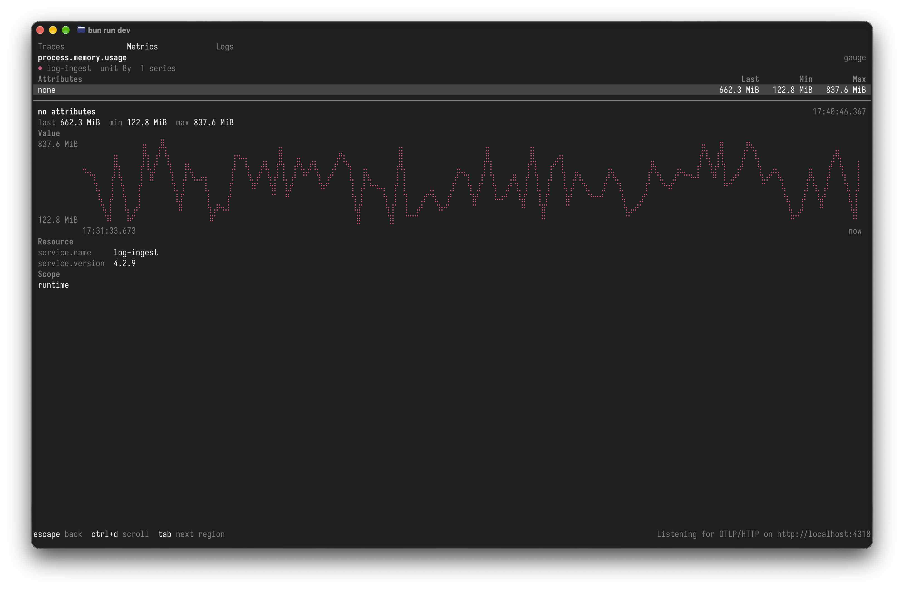
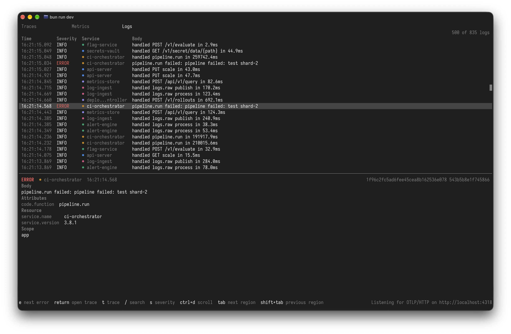

# otel-tui

A terminal app for viewing OpenTelemetry traces, metrics, and logs.

Send it data over OTLP/HTTP and browse it in your terminal.








## Views

- Traces: the trace list works today, and `return` opens a trace as a span
  waterfall with each span's events, attributes, links, and resource. `e`
  jumps to the next trace or span with errors, and `s` shows only traces
  with errors. A duration histogram is planned.
- Metrics: the metric list shows each metric's type, unit, and series count,
  with a panel listing the values each attribute takes, so an attribute that
  blows up cardinality stands out. `return` opens a metric's series with
  their rates, last values, or percentiles, plus the selected series' chart,
  histogram buckets, and exemplars. `o` sorts by name, series count, or last
  update, and `/` searches names, descriptions, services, and attributes. A
  time brush is planned.
- Logs: the log table works today, with a panel for the selected log's body,
  attributes, resource, and trace ID. `e` jumps to the next error, `return`
  opens the selected log's trace, `t` shows only the logs in that trace, `s`
  raises the minimum severity, and `/` searches bodies, attributes, services,
  and trace IDs. A severity histogram is planned.

## Usage

Requires [Bun](https://bun.sh).

```shell
bun install
bun run start
```

Point your OTLP/HTTP exporter at `http://localhost:4318`. Data lives in memory
and auth is off, so it only suits local use.

| Variable                     | Default | Meaning                      |
| ---------------------------- | ------- | ---------------------------- |
| `OTEL_TUI_PORT`              | `4318`  | Port the receiver listens on |
| `OTEL_TUI_RETENTION_MINUTES` | `60`    | How long telemetry is kept   |

## Development

Sample data comes from OpenTelemetry's
[`telemetrygen`](https://github.com/open-telemetry/opentelemetry-collector-contrib/tree/main/cmd/telemetrygen)
(`go install github.com/open-telemetry/opentelemetry-collector-contrib/cmd/telemetrygen@latest`):

```shell
bun run start        # in one terminal
bun run gen:traces   # in another (also gen:logs, gen:metrics)
```

For realistic data, `bun run demo:up` runs the
[OpenTelemetry Demo](https://opentelemetry.io/docs/demo/) in Docker: an online
shop of about 20 services in different languages, with a load generator and
feature flags that inject failures. Its collector exports everything to
otel-tui on `OTEL_TUI_PORT`. It needs about 6 GB of memory for Docker; stop it
with `bun run demo:down`.

```shell
bun run check
bun run test
```

## How it works

An in-memory DuckDB runs the receiver from its
[`otlp` community extension](https://duckdb.org/community_extensions/extensions/otlp).
Each view queries DuckDB with SQL built from its own search and filters, and
[OpenTUI](https://opentui.com/) draws the results.

- `src/db/`: DuckDB instance and OTLP receiver.
- `src/tui/`: views and charts.
